

# Muhammad Bilal Talha
**DevOps Engineer | Full Stack Developer**

Mustafa Town, Lahore · [Portfolio](https://bilal-talha.vercel.app/) · [Projects](https://bilal-talha.vercel.app/work) · [LinkedIn](https://linkedin.com/in/muhammad-bilal-talha-225543246) · [Instagram](https://instagram.com/bilal.talha__) · bilalsaeed000095@gmail.com

 

*I engineer systems that eliminate manual bottlenecks and refuse to break under load.*

*From ripping entire cloud environments out of AWS and anchoring them on bare-metal on-prem clusters behind zero-trust tunnels, to shipping edge-AI vision pipelines on NVIDIA and Hailo hardware that erase thousands of hours of repetitive human labor.*

*Every deployment is automated. Every release gate is deterministic. No open ports, no manual intervention, no wasted cycles.*

*Ship resilient code, own your infrastructure from the kernel up, and let the machines do the heavy lifting.*

---

### Impact at a Glance

- **35+ hrs/week** of manual AI team workload eliminated via automated full-stack AI pipelines
- **3x faster** data labeling achieved with an internal GPU-accelerated SAM annotation tool
- **100% cloud-to-on-prem** environment migration (3 production apps + Dev/UAT/Prod workloads) with zero open inbound ports
- **35% reduction** in manual client response time via a custom customer portal and Lark Suite workflow automation
- **17+ production & personal systems** shipped across Full Stack, Edge AI, and DevOps infrastructure

---

### Engineering Experience

**Salestech** | Full Stack & DevOps Engineer
- Architecting production web applications, microservices, and self-hosted Linux/cloud infrastructure.
- Developing **Maika.digital** (hybrid vector + BM25 dental billing engine) and **SentinelGate** (autonomous static/runtime CI/CD release gatekeeper).

**xis.ai** | Software Engineer (Full Stack & DevOps)
- Shipped 5 production systems, including 3 factory inspection applications for **Rexroth Ctrl-X** (live camera inspection, restricted-area alerts, and radar image checks) from UI to backend.
- Deployed containerized edge-AI workloads onto **NVIDIA** and **Hailo** production devices via Kubernetes (`kubectl`) and automated CI/CD pipelines.
- Built a company-wide GPU-accelerated annotation platform using **SAM (Segment Anything Model)**, **PyTorch**, and **PyCUDA**, accelerating labeling throughput by 3x.
- Integrated **MQTT** across services for real-time, event-driven telemetry and engineered a shared licensing system across 3 production applications.

**SecureQuanta** | Software Engineer (Full Stack & DevOps)
- Migrated the entire infrastructure from AWS (`ECS`, `ECR`, `ALB`, `ACM`, `RDS`, `S3`, `VPC`) and DigitalOcean onto on-premise Ubuntu servers.
- Published 4 on-premise web applications securely using **Cloudflare Tunnels** and Zero Trust access policies without exposing a single inbound port.
- Built 3 core web platforms — a customer portal and ticketing system with **Lark Suite** automation, the corporate web platform, and **SQ Secure** (email and identity breach scanner).
- Replaced manual releases across Dev, UAT, and Production with automated GitHub Actions and Jenkins CI/CD pipelines and Terraform IaC.

---

### Technical Expertise

| Domain | Stack & Tooling |
| :--- | :--- |
| **Cloud & Infrastructure** | AWS (EC2, ECS, ECR, Lambda, VPC, ALB, RDS, S3, IAM, Route 53), Terraform, Kubernetes (`kubectl`), Docker, DigitalOcean, GCP, Azure, Linux, Bash |
| **CI/CD & Zero-Trust Security** | GitHub Actions, Jenkins, Cloudflare Tunnels, Zero Trust Access, DNS, SSL/TLS, Load Balancing, Network Policies |
| **Backend & Messaging** | Python, Django, FastAPI, Flask, Node.js, Express.js, REST APIs, MQTT, Event-Driven Architecture, Microservices |
| **Frontend** | React, Next.js, TypeScript, JavaScript, Tailwind CSS, Redux, Three.js |
| **AI & Edge Inference** | SAM (Segment Anything Model), PyTorch, TorchVision, ONNX, TensorRT, PyCUDA, NVIDIA & Hailo Edge Deployment, RAG Pipelines |
| **Databases & Testing** | PostgreSQL, `pgvector`, MongoDB, MySQL, Redis, Jest, pytest |

---

### Featured Repositories & Interactive Portfolios

- **[Resume-rag-bot](https://github.com/bilal-talha-dev/Resume-rag-bot)**: Scalable RAG engine for unlimited candidate resumes using Django, PostgreSQL (`pgvector`), Gemini API with deterministic local fallback, and automated PDF evaluation reports.
- **[grepguru-bot](https://github.com/bilal-talha-dev/grepguru-bot)**: Automated CLI and system workflow utilities.
- **[smart-entry-system](https://github.com/bilal-talha-dev/smart-entry-system)**: 3-tier facial recognition attendance platform built with Next.js, Flask, and Docker.
- **[cvat](https://github.com/bilal-talha-dev/cvat)**: Computer Vision Annotation Tooling workflows and setups.
- **[portfolio](https://github.com/bilal-talha-dev/portfolio)**: Main developer portfolio ([bilal-talha.vercel.app](https://bilal-talha.vercel.app/)) alongside interactive **3D Minecraft** and **Windows XP** themed portfolio editions.
- **Online Compiler & Marine Inventory Systems**: Sandboxed Python/C++ execution engine in Docker and full-stack MERN inventory architecture.

> *Due to NDA commitments, proprietary implementation details are omitted here. For high-level architecture walkthroughs and more details on all 17 systems, visit **[bilal-talha.vercel.app/work](https://bilal-talha.vercel.app/work)**.*

---

### Education & Certifications

- **BS Software Engineering** — University of the Punjab (CGPA: 3.77 / 4.00)
- **Certifications:** Fortinet Fundamentals in Cybersecurity · MERN Stack Development · Python

---

### GitHub Statistics

  
    
  

---

### Architecture Diagrams

> *All diagrams below are initially collapsed and show high-level, NDA-safe architectural flows. For interactive layer filtering and more details, visit **[bilal-talha.vercel.app/work](https://bilal-talha.vercel.app/work)**.*

<b>Click to expand Production Architecture Blueprints (13 Diagrams)</b>

 

<table>
  <tr>
    <td width="50%" align="center">
      <b>01. AWS to On-Prem Zero-Trust Migration</b>  
      
    </td>
    <td width="50%" align="center">
      <b>02. Cloudflare Tunnel &amp; Zero-Trust Network</b>  
      
    </td>
  </tr>
  <tr>
    <td width="50%" align="center">
      <b>03. Hybrid Vector + BM25 RAG Engine</b>  
      
    </td>
    <td width="50%" align="center">
      <b>04. NVIDIA &amp; Hailo Edge-AI Telemetry</b>  
      
    </td>
  </tr>
  <tr>
    <td width="50%" align="center">
      <b>05. SentinelGate CI/CD Release Gatekeeper</b>  
      
    </td>
    <td width="50%" align="center">
      <b>06. Transactional Outbox &amp; Event Bus</b>  
      
    </td>
  </tr>
  <tr>
    <td width="50%" align="center">
      <b>07. GPU-Accelerated SAM Annotation Pipeline</b>  
      
    </td>
    <td width="50%" align="center">
      <b>08. Multi-Tenant K8s Cluster &amp; Ingress</b>  
      
    </td>
  </tr>
  <tr>
    <td width="50%" align="center">
      <b>09. Distributed Licensing &amp; Auth Engine</b>  
      
    </td>
    <td width="50%" align="center">
      <b>10. Sandboxed Docker Code Execution</b>  
      
    </td>
  </tr>
  <tr>
    <td width="50%" align="center">
      <b>11. 3-Tier Facial Recognition Pipeline</b>  
      
    </td>
    <td width="50%" align="center">
      <b>12. Terraform IaC Multi-Env Provisioning</b>  
      
    </td>
  </tr>
  <tr>
    <td colspan="2" align="center">
      <b>13. End-to-End Automated DevSecOps &amp; Observability Mesh</b>  
      
    </td>
  </tr>
</table>

<b>Click to expand Edge AI &amp; Computer Vision Flows (7 Portfolio Systems)</b>

**01. GPU Annotation Tool (SAM Microservice)** · [For more details, visit portfolio →](https://bilal-talha.vercel.app/work/annotate)

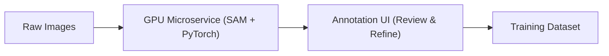

**02. Production Inference System (Live Inspection)** · [For more details, visit portfolio →](https://bilal-talha.vercel.app/work/inference)

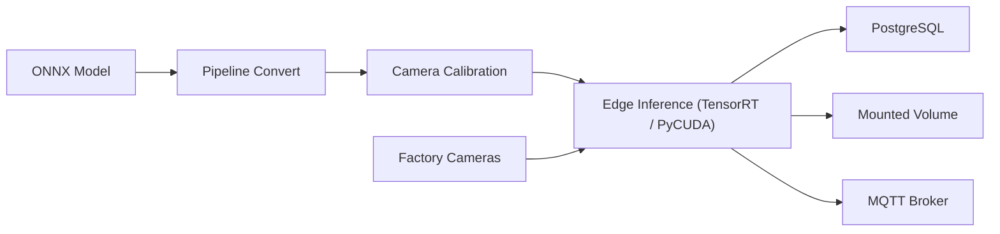

**03. AI Pipelines Bridge (Full-Stack Integration)** · [For more details, visit portfolio →](https://bilal-talha.vercel.app/work/pipeline)

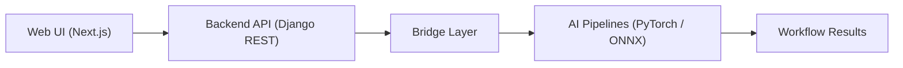

**04. Restricted Area Alert System (NVIDIA Ctrl-X)** · [For more details, visit portfolio →](https://bilal-talha.vercel.app/work/zone)

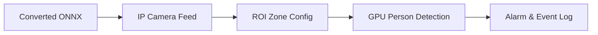

**05. Radar Image Inspection (Hailo Accelerator)** · [For more details, visit portfolio →](https://bilal-talha.vercel.app/work/radar)

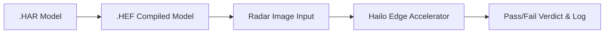

**06. Shared Licensing System (Ctrl-X Apps)** · [For more details, visit portfolio →](https://bilal-talha.vercel.app/work/license)

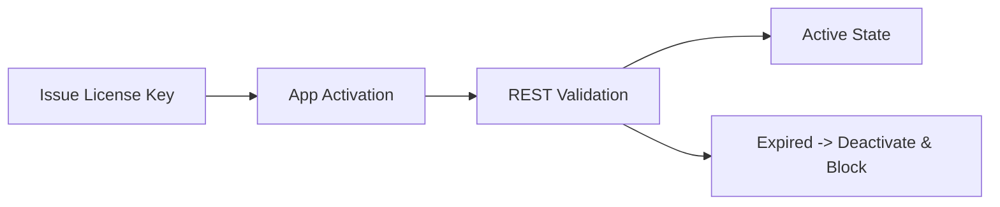

**07. On-Prem CI/CD & Kubernetes Delivery** · [For more details, visit portfolio →](https://bilal-talha.vercel.app/work/onprem)

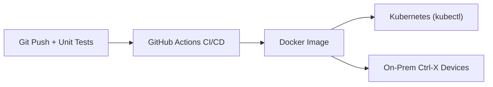

<b>Click to expand Cloud Migration, Zero-Trust &amp; Enterprise Flows (7 Portfolio Systems)</b>

**08. AWS to On-Prem Migration** · [For more details, visit portfolio →](https://bilal-talha.vercel.app/work/migration)

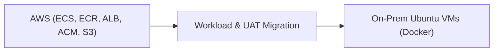

**09. Zero-Trust Publishing (Cloudflare Tunnel)** · [For more details, visit portfolio →](https://bilal-talha.vercel.app/work/tunnel)

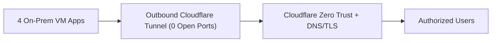

**10. Multi-Environment CI/CD Pipelines** · [For more details, visit portfolio →](https://bilal-talha.vercel.app/work/cicd)

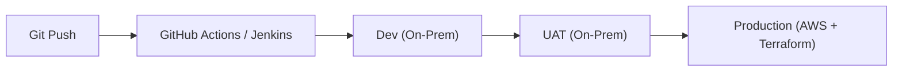

**11. Customer Portal & Ticket Automation** · [For more details, visit portfolio →](https://bilal-talha.vercel.app/work/portal)

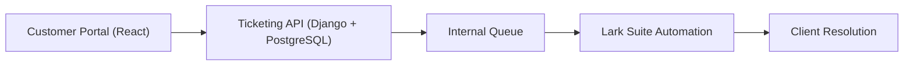

**12. Corporate Web Platform & Careers** · [For more details, visit portfolio →](https://bilal-talha.vercel.app/work/site)

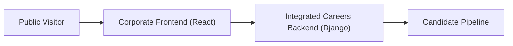

**13. SQ Secure (Exposure Scanner)** · [For more details, visit portfolio →](https://bilal-talha.vercel.app/work/sqsecure)

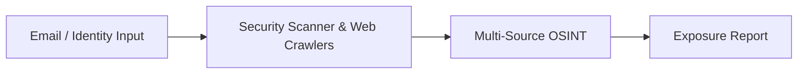

**14. DigitalOcean Architecture & Security Assessment** · [For more details, visit portfolio →](https://bilal-talha.vercel.app/work/digitalocean)

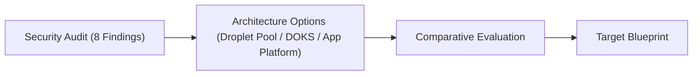

<b>Click to expand Personal &amp; Academic System Flows (3 Portfolio Systems)</b>

**15. Online Compiler (Sandboxed Execution)** · [For more details, visit portfolio →](https://bilal-talha.vercel.app/work/compiler)

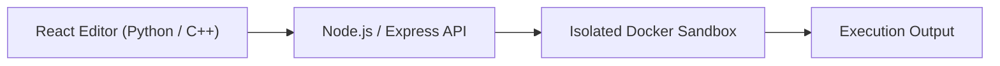

**16. Blog Platform (MERN Stack)** · [For more details, visit portfolio →](https://bilal-talha.vercel.app/work/blog)

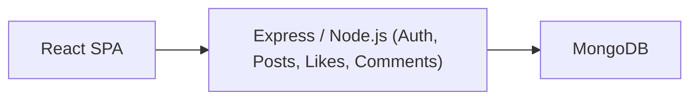

**17. Smart Entry Management (3-Tier FYP)** · [For more details, visit portfolio →](https://bilal-talha.vercel.app/work/fyp) · [GitHub Repo](https://github.com/bilal-talha-dev/smart-entry-system)

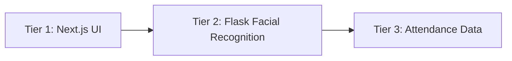

